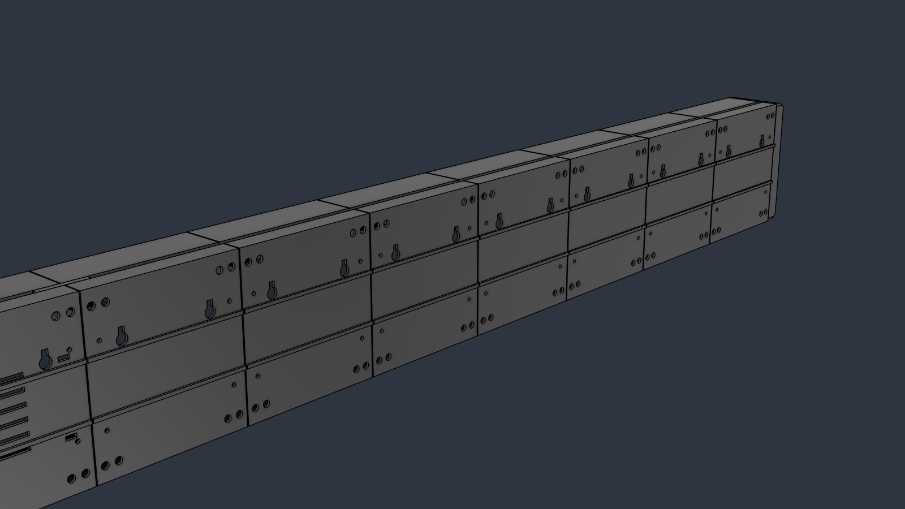
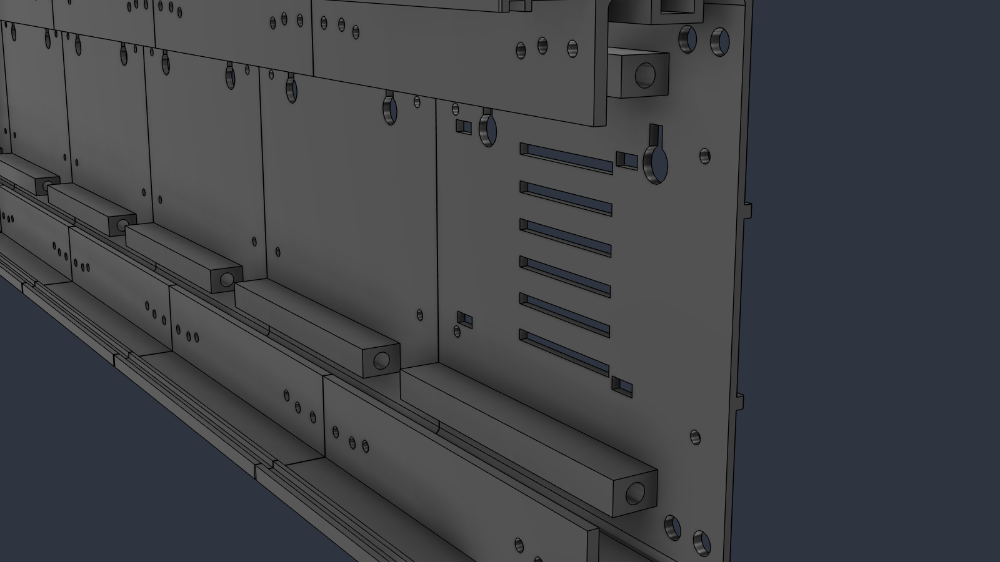
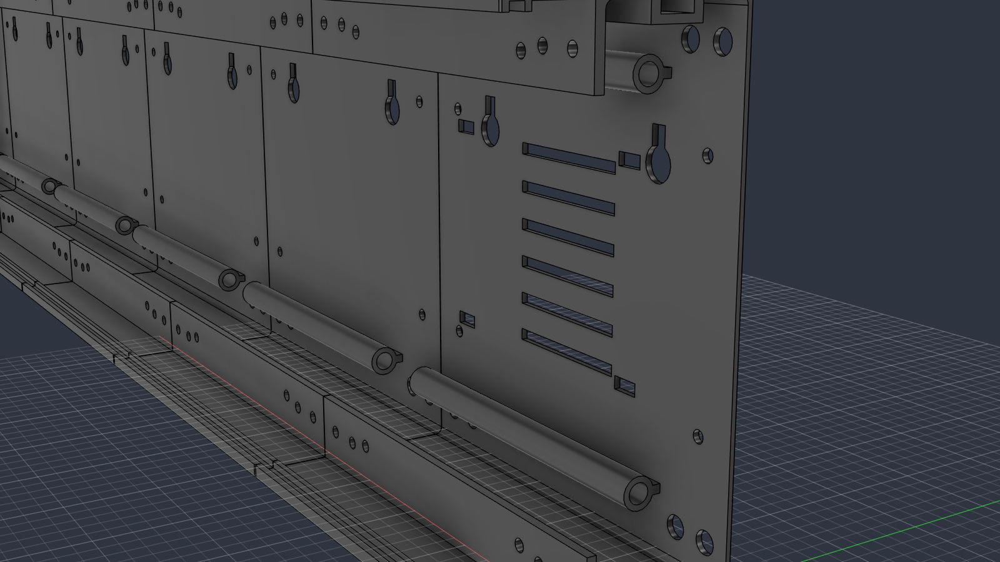

# LEDBox

A modular, 3D-printable enclosure for a single row of HUB75 LED matrix panels (P1, P2, P2.5, P3, P4, P5 and similar). It prints in short sections that stack end to end on two threaded bars, with rounded end caps, a slot for a tinted acrylic front, and room inside for a power supply and controller.

It was designed for a live train departure board made from four P4 256 × 128 mm panels (a 1024 × 128 mm display), but the Fusion model is parametric: pick a panel size from a list, set how many panels you have, and the whole design resizes.



> **Status: early release.** Only short test slices have been printed so far. A full enclosure has not yet been assembled, and several dimensions are still estimates (see [Measure your panel first](#measure-your-panel-first)). Print the test slice and check it against your own panel before printing a full set.

## Two versions: thick and thin

Both versions share the same layout, hardware and parameters. They differ in how much plastic they use.

| | **Thick** | **Thin** |
|---|---|---|
| Top, bottom and back walls | 2.4 mm | 1.6 mm |
| Bar tubes | Solid square blocks | Thin round tubes |
| Panel mounting lips | 22 mm × 3 mm | 16 mm × 2.4 mm |
| Stiffening ribs on the back | Yes | No |
| Plastic per section (P4 256 × 128) | about 122 cm³ | about 77 cm³ |
| Estimated print time per section | about 4.5 hours | about 2.75 hours |
| Section profile (P4 256 × 128) | 137.4 × 63.4 mm | 135.8 × 61.4 mm |
| Best for | Public or knock-prone places | Faster printing, indoor use |

Print times are estimates scaled from a test slice at 0.2 mm layers with a 0.4 mm nozzle.

| Thick | Thin |
|---|---|
|  |  |

## What's in this repository

```
thick/
  LEDBox-thick.f3d        Fusion file, fully parametric
  stl/                    Ready-to-print parts for 4 x P4 256x128 panels
thin/
  LEDBox-thin.f3d
  stl/
images/
```

The STL files are for **four P4 256 × 128 mm panels** with the screw positions measured from one particular panel. For any other panel, or if your screw holes differ, open the Fusion file and follow [Changing the design](#changing-the-design).

## Parts to print

For four P4 256 × 128 panels (each panel sits on two 128 mm sections):

| File | Quantity | Notes |
|---|---|---|
| `section-vented-psu.stl` | 1 | Vents and power supply mounting slots. Goes at the mains end. |
| `section-plain.stl` | 6 | Solid back with wall-mount keyholes. |
| `section-plain-mirrored-end.stl` | 1 | Goes at the far end. |
| `end-cap-mains.stl` | 1 | Opening for an IEC C14 mains inlet. |
| `end-cap-controller.stl` | 1 | Mounting posts and a cable opening for a controller board. |
| `joiner-key.stl` | up to 7 | Optional. Slides into the top slot across each joint to keep sections aligned. |
| `test-slice.stl` | 1 | Optional but recommended. A short piece of a section for checking fit. |

For other sizes: the number of sections is the number of panels × sections per panel. One is vented, one is the mirrored end, and the rest are plain.

### Print settings

- **Material:** PETG or ASA. PLA softens at around 55 to 60 °C and is only suitable for test pieces.
- **Supports:** none.
- **Sections:** stand them on end. Put the end where the bar tubes run right to the face on the bed, so the short recess is at the top.
- **End caps:** outer end face on the bed.
- **Joiner keys:** flat.
- The files are exported lying down as modelled, so rotate them in your slicer.

## Hardware

For four P4 256 × 128 panels:

| Item | Quantity |
|---|---|
| M5 threaded bar, cut to 990 mm | 2 |
| M5 nuts and washers | 4 of each |
| M3 screws for the panels, about 6 to 8 mm long | to suit your panel's inserts |
| M3 heat-set inserts (4.6 mm outside diameter type) | 4 for the end caps, 4 more if you mount a controller |
| M3 screws, about 6 mm, for the end caps | 4 |
| 3 mm acrylic sheet, 132 × 1024 mm (tinted or smoked) | 1 |
| M5 square nuts and eye bolts, for hanging | as needed |
| 5 V power supply. The mounting slots suit a Mean Well LRS-35-5 or LRS-50-5 | 1 |
| Snap-in fused IEC C14 inlet | 1 |

For other sizes, open the Fusion file and read `rod_len` (bar length) and `acr_h` (acrylic height) from the parameter list. The acrylic is as long as the row of panels.

## Assembly

1. Plug the ribbon and power cables into each panel.
2. Screw the panels to the section lips from behind. Each lip has holes for the panel's threaded inserts, and there is a screwdriver hole in the back wall directly behind each one.
3. Push the sections together and feed the two threaded bars through the tubes.
4. Fit a washer and nut on each end and tighten. The tubes stop 24 mm short at the outer ends to leave room for the nut and a socket.
5. Fit the power supply to the vented section and the controller to its end cap.
6. Slide the acrylic sheet into the front groove from one end.
7. Screw on the end caps.

**To hang it:** slide M5 square nuts into the slot along the top and fit eye bolts for chain or wire. **To wall-mount it:** use the keyholes in the back.

## Safety

The enclosure can hold a mains power supply. If you fit one:

- Earth the supply, and fit its terminal cover.
- Use a fused inlet with proper strain relief on the lead.
- Keep the vents clear.
- If you are not confident with mains wiring, use an external 5 V supply and keep mains out of the enclosure. For a public place, an external supply or a metal enclosure for the mains part is the safer choice.

HUB75 panels run on 5 V only. Feeding them 12 V destroys them.

## Changing the design

You don't need to know Fusion to resize LEDBox. Everything is controlled from one table of numbers.

### 1. Install Fusion and open the file

1. Download Autodesk Fusion from autodesk.com. A free personal-use licence is available for hobby use.
2. Download `LEDBox-thick.f3d` or `LEDBox-thin.f3d` from this repository.
3. In Fusion, choose **File > Open**, click **Open from my computer**, and select the file.

### 2. Open the parameter table

1. Check the box at the top left of the screen says **DESIGN**.
2. In the toolbar, click **MODIFY**, then **Change Parameters** at the bottom of the menu.
3. A table opens. The section called **User Parameters** holds every setting. Each row has a name, a value in the **Expression** column, and a comment saying what it does.

### 3. Change a value

1. Click the value in the **Expression** column.
2. Type the new value. Include the unit for lengths, for example `7.5 mm`.
3. Press **Enter**. The model rebuilds, which can take a few seconds.
4. Click **OK** to close the table.

### 4. Pick your panel

Set `preset` to the number for your panel, and `panel_count` to how many panels are in your row.

| preset | Pitch | Panel size (mm) | Pixels |
|---|---|---|---|
| 1 | P1 | 160 × 160 | 160 × 160 |
| 2 | P1 | 320 × 160 | 320 × 160 |
| 3 | P2 | 128 × 128 | 64 × 64 |
| 4 | P2 | 256 × 128 | 128 × 64 |
| 5 | P2 | 320 × 160 | 160 × 80 |
| 6 | P2.5 | 160 × 80 | 64 × 32 |
| 7 | P2.5 | 160 × 160 | 64 × 64 |
| 8 | P2.5 | 320 × 160 | 128 × 64 |
| 9 | P2.5 | 320 × 320 | 128 × 128 |
| 10 | P3 | 192 × 96 | 64 × 32 |
| 11 | P3 | 192 × 192 | 64 × 64 |
| 12 | P3 | 288 × 96 | 96 × 32 |
| 13 | P3.076 | 320 × 160 | 104 × 52 |
| 14 | P4 | 128 × 128 | 32 × 32 |
| 15 | P4 | 256 × 128 | 64 × 32 |
| 16 | P4 | 256 × 256 | 64 × 64 |
| 17 | P4 | 320 × 160 | 80 × 40 |
| 18 | P5 | 160 × 160 | 32 × 32 |
| 19 | P5 | 320 × 160 | 64 × 32 |

For a size that isn't listed, set `preset` to `0` and enter your panel's size in `custom_w` and `custom_h`.

### Measure your panel first

The preset sets the panel's outside size only. Screw positions and thickness vary between manufacturers, so measure your own panel and enter these:

| Parameter | What to measure | Current value |
|---|---|---|
| `insert_x` | Screw hole centre, from the end of the panel | 7.5 mm (measured on one P4 panel) |
| `insert_y` | Screw hole centre, from the top or bottom edge | 7.5 mm (measured) |
| `insert_x2` | A second screw hole, from the end of the panel | 18 mm (estimate) |
| `pin_x`, `pin_y` | Locator pin centre, from the end and from the edge | 26 mm, 9 mm (measured) |
| `pin_d` | Hole for the locator pin | 3.4 mm, for a 3 mm pin |
| `panel_thk` | Panel thickness, LED face to the back of its plastic frame | 15 mm (estimate) |

The model puts the same hole pattern at both ends of every section, so holes your panel doesn't use are simply left empty.

### Other useful settings

| To change | Parameter |
|---|---|
| Printer build height, which decides whether each panel gets one section or two | `bed_z` |
| Power supply: 1 = LRS-35-5 or LRS-50-5, 2 = LRS-75-5, 3 = LRS-100-5 | `psu_model` |
| Power supply mounting hole positions (estimates, check the datasheet) | `psu_hole_x0`, `psu_hole_sx`, `psu_hole_y0`, `psu_hole_sy` |
| Controller board hole spacing (estimate) | `ctrl_sy`, `ctrl_sz` |
| Mains inlet cut-out | `iec_w`, `iec_h` |
| Acrylic thickness | `acr_thk` |
| Wall thickness | `wall`, `back_thk` |
| Fit, if parts come out tight or loose | `clr`, `sur_gap` |
| Hole size for heat-set inserts | `hs_d`, `hs_depth` |
| Length of the test slice | `test_len` (the slice itself does not update, see below) |

Some rows are calculated for you and are there to read, not edit: `rod_len` (bar cut length), `acr_h` (acrylic height), `frame_h` and `total_depth` (overall size), and `psu_fits`, which shows `1` if the power supply fits behind the panel and `0` if it doesn't.

### 5. Check the model rebuilt

Look along the timeline strip at the bottom of the screen. If any icon has turned yellow or red, a feature failed to rebuild; hover over it to see why. The usual cause is an extreme value, so undo the last change with **Ctrl+Z** (**Cmd+Z** on a Mac).

### 6. Export parts for printing

1. In the browser panel on the left, expand the part you want, then its **Bodies** folder.
2. Right-click the body and choose **Save As Mesh**.
3. Choose **STL** or **3MF**, click **OK**, and pick where to save it.
4. Repeat for each different part. You only need one file per part type; print the plain section as many times as you need.

### Things that don't update automatically

- **The test slice** is a fixed copy and is hidden in the file. After changing parameters, export a section and cut a short piece in your slicer instead.
- **The STL files in this repository** are for the default size only.

## Known limits

- **Tall panels:** panels 256 mm or taller give a section profile bigger than a 256 mm print bed.
- **Short panels:** on 80 mm and 96 mm tall panels there is no room for the power supply behind the panel. Use an external supply.
- **Long rows:** rows longer than about 1 m need threaded bar longer than the standard 1 m length. Check `rod_len`.
- **Larger power supplies:** the LRS-75-5 and LRS-100-5 are 97 mm wide. Check `psu_fits` for your panel.
- **End cap corners:** very small panels may be too small for the default corner radius. If the end cap fails to rebuild, reduce `cap_r` and `cap_c`.

## Credits

Designed in Autodesk Fusion with Claude.
